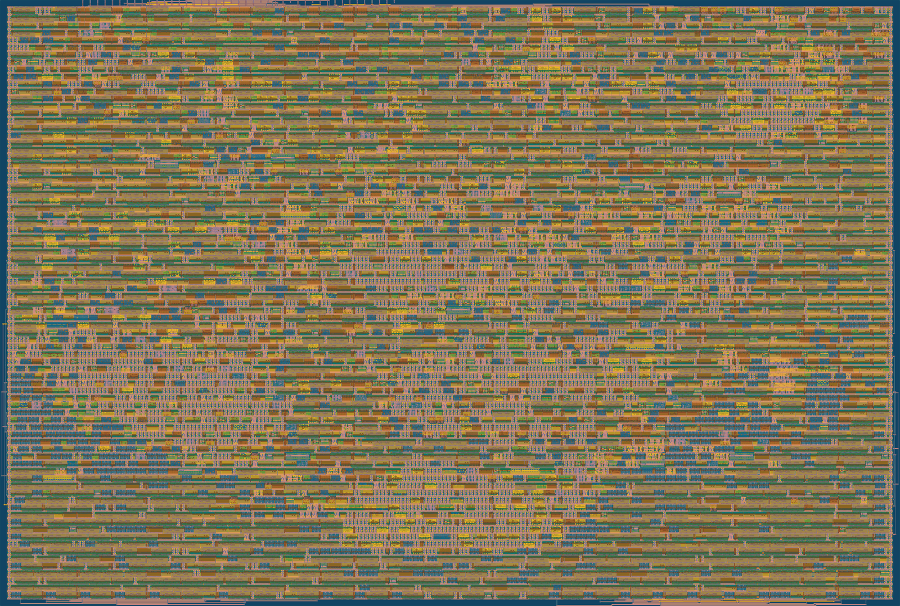

   

# tt_um_santhosh_rvsoc: RV32EC microcontroller for Tiny Tapeout SKY 26d

A 32-bit RISC-V SoC (TinyQV class) in 2x2 tiles on sky130A: a 4-bit-serial
RV32EC CPU that executes in place from QSPI flash, uses two QSPI PSRAMs as RAM,
and has a UART with programmable baud rate, 8 GPIO in/out, a 32-bit timer with
compare interrupt and two external interrupt pins. Based on TinyQV by Michael
Bell (Tiny Tapeout 6).

**Status:** hardened at 64 MHz in 2x2 tiles; DRC/LVS/antenna clean, hold met at
all corners, setup met at the typical corners; Tiny Tapeout precheck passed;
RTL and gate-level tests pass. Not yet submitted.



| Document | Contents |
|----------|----------|
| [docs/DESIGN_REPORT.md](docs/DESIGN_REPORT.md) | Full design report (journal style): requirements, architecture, verification, physical design, every decision |
| [docs/info.md](docs/info.md) | Datasheet: architecture, memory map, registers, interrupts, boot, how to test |
| [docs/IO_GUIDE.md](docs/IO_GUIDE.md) | Every input you give and every output you get, pin by pin |
| [docs/fpga.md](docs/fpga.md) | Running the same RTL on a PYNQ-Z2 FPGA |
| [STATUS.md](STATUS.md) | Build log, design decisions, remaining manual steps |
| [reports/summary.md](reports/summary.md) | Area, timing, DRC/LVS, test results |
| [reports/sweep.md](reports/sweep.md) | Every hardening iteration |

## Layout

```
src/        RTL (top: project.v -> tt_um_santhosh_rvsoc; TinyQV core in src/tinyQV)
firmware/   C + assembly demo / self-test firmware (RV32EC), Makefile -> .elf/.bin/.hex
test/       cocotb tests (RTL and gate level), QSPI flash/PSRAM model
fpga/       PYNQ-Z2 harness: BRAM flash/PSRAM emulator, UART checker, Vivado scripts
scripts/    check_env.sh, run_all.sh, harden.sh, gl_test.sh, precheck.sh, sweep_tiles.sh, ...
docs/       datasheet, I/O guide, FPGA guide, design report, images
reports/    summary.md, sweep.md, precheck/
```

## One command

```
scripts/run_all.sh
```

This runs preflight/install, firmware, RTL tests, FPGA harness simulation,
hardening with the Tiny Tapeout flow (LibreLane in Docker), gate-level tests and
reports. Watch the progress with `tail -F logs/live.log`.

## Credits

TinyQV CPU, QSPI controller and memory map: Michael Bell (Apache-2.0). UART: Ben
Marshall (MIT). Integration, timer, programmable UART, firmware, tests and FPGA
harness: Santhosh, 2026. Licensed Apache-2.0 (see LICENSE and src/tinyQV/LICENSE).
