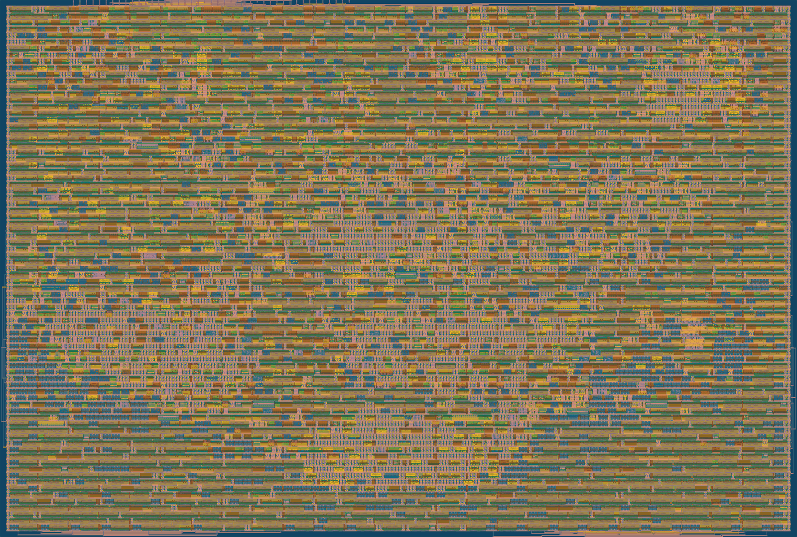
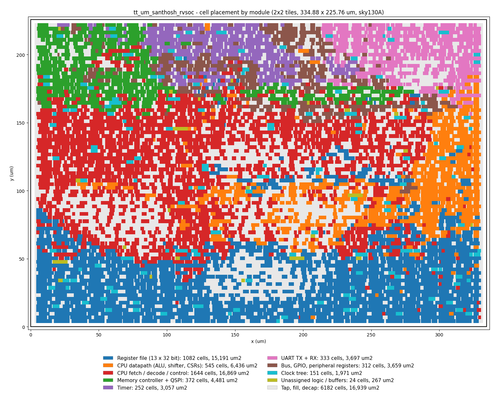

# A 2x2-Tile RV32EC Microcontroller SoC for Tiny Tapeout SKY 26d: Design, Verification and Physical Implementation in SkyWater 130 nm

**Design:** `tt_um_santhosh_rvsoc` | **Shuttle:** Tiny Tapeout SKY 26d | **Process:** SkyWater SKY130 (sky130A, 1.8 V, `sky130_fd_sc_hd`) | **Area:** 2x2 Tiny Tapeout tiles (334.88 x 225.76 um die) | **Target clock:** 64 MHz | **Author:** Santhosh (2026), based on TinyQV by Michael Bell

**Status (10 Nov 2026):** hardened (iteration 8); Magic DRC 0, KLayout DRC 0, LVS clean,
antenna 0, hold met at all 9 corners, setup met at the typical corners (+1.59 ns);
Tiny Tapeout precheck passed; RTL tests 11/11 and gate-level tests 11/11 pass.
PYNQ-Z2 bitstream built with Vivado 2025.1 (timing met at 64 MHz) and verified in
simulation on the RTL and on the post-route FPGA netlist.
Not yet done: GitHub push and submission (manual), FPGA board test (board not yet available).
A practical guide to using the chip is `docs/USER_GUIDE.md`.

> This report documents the complete design: what was built, why each decision
> was made, how it was verified, and how the layout was obtained, with enough
> detail to reproduce every result from the repository. Section 12 lists the
> exact commands and tool versions. Final physical numbers are also kept
> machine-generated in `reports/summary.md`; every hardening attempt is in
> `reports/sweep.md`.

---

## Abstract

We present a complete RISC-V microcontroller system-on-chip that fits in four
Tiny Tapeout tiles (about 0.073 mm2 of core area) of the SkyWater 130 nm process.
The SoC is built around TinyQV, an RV32EC core that processes data four bits per
clock cycle, executes code in place from an external QSPI flash and uses two
external QSPI PSRAMs as data memory, so it needs no on-chip SRAM. Around the core
we integrated a UART with a programmable baud-rate divisor, eight general-purpose
inputs and outputs, two edge-triggered external interrupts and a 32-bit timer with
a compare interrupt. The timer is implemented nibble-serially, in step with the
CPU's 4-bit datapath, which makes torn 32-bit reads impossible and saves area.
Verification combines a firmware self-test that runs every supported instruction,
pin-level system tests and random instruction tests against a reference model,
all repeated on the gate-level netlist, plus a cycle-accurate FPGA harness for a
PYNQ-Z2 board, built with Vivado (timing met at 64 MHz) and verified down to its
post-route netlist. The self-test found two defects in the upstream core (a hang on
`fence` and wrong operands for the CSR immediate instructions); both are fixed.
Physical implementation used the official Tiny Tapeout flow (LibreLane 3.0.14).
Fitting the design into 2x2 tiles took several iterations, which are documented:
removing logic outside the specification, a serial timer and narrower peripheral
read bus, limiting hold repair to real violations and finally a higher placement
density reduced global-routing demand from 98.6 % to 64.8 % of capacity and made
the design routable. The final layout passes DRC, LVS, antenna and hold checks at
all corners, meets setup at 64 MHz at the typical corners (+1.59 ns slack), and
passes the Tiny Tapeout precheck.

---

## 1. Introduction

### 1.1 Motivation

Tiny Tapeout (TT) lets individual designers put digital designs on a real chip by
sharing one multi-project die. Each design gets one or more "tiles" of roughly
161 x 112 um and 26 signals: 8 inputs, 8 outputs, 8 bidirectional pins, a clock
and a reset. A processor capable of running compiled C code is far larger than a
single tile, and on-chip memory is very expensive in area. TinyQV (Michael Bell,
TT06) showed that a 32-bit RISC-V CPU fits in 2x2 tiles if (a) the datapath is
4 bits wide and processes a 32-bit word over 8 clock cycles, and (b) all memory
is external, reached over a 4-bit QSPI bus.

### 1.2 Goal and constraints

The goal was a submission-ready TinyQV-class microcontroller for the SKY 26d
shuttle (projects close 30 Nov 2026) with:

- RV32E + C instruction set, execute-in-place from QSPI flash, PSRAM as RAM;
- UART (8N1, programmable baud), 8 GPIO out, 8 GPIO in, 32-bit timer with compare
  interrupt, external interrupt pins;
- 64 MHz clock, timing closed in the TT flow's STA;
- 2x2 tiles (fallback 3x2 only after an iteration budget), clean DRC/LVS/antenna;
- RTL and gate-level tests, demo firmware, documentation and one-command automation.

Free tiles are scarce, so area had priority over features.

### 1.3 Contributions

1. An integrated SoC (`src/project.v`) that keeps the TT06 TinyQV memory map and
   pinout but replaces debug/SPI blocks with the MVP peripherals of the spec.
2. A nibble-serial 32-bit timer (`src/timer.v`) locked to the CPU's nibble counter.
3. Two upstream core fixes found by our own ISA self-test (Section 5.2).
4. A layered verification environment that runs the same tests on RTL and gates,
   plus an FPGA harness that emulates the QSPI Pmod in block RAM.
5. A documented area/routability closure study in 2x2 tiles (Section 8).

---

## 2. Background

### 2.1 Tiny Tapeout SKY 26d

| Item | Value |
|------|-------|
| Process | SkyWater SKY130, PDK variant sky130A (open_pdks 8afc8346) |
| Std cells | `sky130_fd_sc_hd` (high density) |
| Supply | 1.8 V core |
| Tile | about 161 x 112 um; 2x2 gives a 334.88 x 225.76 um die, 329.36 x 220.32 um core |
| Routing layers for user designs | met1 to met4 (met5 is reserved for the TT power grid) |
| Flow | tt-support-tools + LibreLane 3.0.14 (OpenROAD, Yosys, Magic, KLayout, Netgen) |
| I/O | 8 in (`ui_in`), 8 out (`uo_out`), 8 bidir (`uio_*` + `uio_oe`), `clk`, `rst_n`, `ena` |
| I/O speed | outputs about 33 MHz, inputs about 66 MHz through the TT multiplexer |

### 2.2 TinyQV

TinyQV (Apache-2.0) is an RV32EC CPU designed for minimal area. Its 32-bit
registers are shift registers that rotate by 4 bits every clock, so one 4-bit ALU
processes a 32-bit operand in 8 clocks. A QSPI memory controller fetches 16-bit
instruction parcels from flash in continuous-read (XIP) mode and performs data
reads and writes to two QPI PSRAMs. Upstream TT06 also had an SPI controller, a
debug UART and debug outputs. We started from the TT06 version (`tt06-tinyQV`,
tinyQV commit dfbd5e38), not the later multi-tile "crowd-sourced" TinyQV.

---

## 3. Requirements and how they are met

| # | Requirement | Where met |
|---|-------------|-----------|
| R1 | TT top-level interface, 26 signals, no floating outputs | `src/project.v` (all outputs driven) |
| R2 | 32-bit RISC-V, 4-bit datapath, RV32E + C + minimal Zicsr/trap | TinyQV core, Sections 4.2 and 5 |
| R3 | Execute in place from QSPI flash, PSRAM A/B as RAM, no on-chip SRAM | Section 4.3 |
| R4 | UART 8N1 with programmable divisor | `UART_DIV` register, Section 4.4 |
| R5 | GPIO: 8 out (read/write), 8 in | `GPIO_OUT`, `GPIO_IN`, `GPIO_SEL` |
| R6 | 32-bit timer with compare interrupt | `src/timer.v`, Section 4.5 |
| R7 | Keep upstream memory map and register layout | Section 4.6 |
| R8 | 64 MHz, setup/hold pass in the flow's STA | Section 8.5 |
| R9 | 2x2 tiles, no DRC/LVS/antenna errors | Section 8 |
| R10 | Tests: boot, UART "Hello, TT!", GPIO loopback, timer IRQ, PSRAM, every instruction; RTL and gate level | Section 7 |
| R11 | C firmware for RV32E with banner, GPIO pattern, timer tick | `firmware/`, Section 6 |
| R12 | Datasheet, reports, one-command automation | `docs/`, `reports/`, `scripts/run_all.sh` |

---

## 4. Architecture

### 4.1 Block diagram

```
                     tt_um_santhosh_rvsoc  (2x2 tiles, 64 MHz)
   +---------------------------------------------------------------------+
   |                                                                     |
   |   +-------------------------- tinyQV ----------------------------+  |
   |   |  tinyqv_cpu: fetch buffer (4 x 16 bit), decode, PC, CSRs,     |  |
   |   |              interrupts/traps, load/store sequencing          |  |
   |   |  tinyqv_core: 13 x 32-bit rotating registers (x1,x2,x5..x15)  |  |
   |   |              4-bit ALU, shifter, branch compare               |  |
   |   |  tinyqv_mem_ctrl + qspi_controller: XIP flash + 2 x PSRAM     |  |
   |   +----+---------------------------------------------+-----------+  |
   |        | data bus: 28-bit address, 32-bit data,      | QSPI        |
   |        | read 4 bits per clock (nibble k at phase k) | 4-bit bus   |
   |   +----+------------------------------------+        |             |
   |   | peripheral decode 0x8000000-0x800003F   |        |             |
   |   |  GPIO_OUT/IN/SEL   UART (TX, RX, DIV)   |        |             |
   |   |  TIMER (COUNT, CMP, nibble-serial)      |        |             |
   |   +--+---------+---------+--------+---------+        |             |
   |      |         |         |        | IRQ 0..3         |             |
   +------+---------+---------+--------+------------------+-------------+
          |         |         |                           |
       uo[7:0]    ui[7:0]   ui[7] RX / uo[0] TX       uio[7:0]
       (GPIO)   (GPIO, IRQ)                          (QSPI Pmod: flash CS#, SD0-3,
                                                      SCK, PSRAM A CS#, PSRAM B CS#)
```

### 4.2 CPU core

**Datapath.** Every 32-bit quantity (register, ALU operand, address, store data,
CSR) moves 4 bits per clock. A 3-bit nibble counter (`counter_hi`) runs 0..7
continuously; in phase *k* the core works on bits [4k+3:4k]. A simple
instruction therefore takes at least 8 clocks; shifts, compares and loads/stores
take more.

**Register file.** RV32E has 16 registers. `x0` is constant 0, and TinyQV
hard-wires `gp` (x3) = 0x1000400 and `tp` (x4) = 0x8000000 (the PSRAM global
pointer area and the peripheral base), so only 13 registers are stored:
13 x 32 = 416 flip-flops, each register rotating by 4 bits per clock. Upstream
places a `sky130_fd_sc_hd__dlygate4sd3_1` delay cell on each rotating bit
(364 cells) as a fixed hold-time fix (see Section 8.3, iteration 5).

**Instruction fetch.** The CPU keeps a small prefetch buffer of 16-bit parcels
filled by the QSPI controller from flash in continuous-read mode. Branches restart
the fetch. Code may only execute from flash (24-bit code addresses).

**ISA.** RV32E base, C (compressed), Zicsr, `ecall`, `ebreak`, `mret`. TinyQV
also decodes some Zcb compressed instructions and custom multi-register
loads/stores; they are kept (removing them saves only about 0.8 % area). No
misaligned-access or illegal-instruction trap is implemented (upstream behaviour).

**CSRs.** `mstatus` (MIE, MPIE, plus TinyQV's non-standard trap-enable bit),
`misa` (reads 0x40000014 = RV32 + C + E), `mie`, `mip`, `mepc` (24 bits),
`mcause`. The Zicntr counters were removed for area (Section 5).

**Traps and interrupts.** Fixed vectors: reset 0x0, trap (`ecall`, `ebreak`) 0x4,
interrupt 0x8. Four interrupt sources map to `mip`/`mie` bits 16..19, with
`mcause` = 0x80000010 + n:

| n | Source | Type |
|---|--------|------|
| 0 | `ui_in[0]` | rising edge, latched in `mip`, cleared by software |
| 1 | `ui_in[1]` | rising edge, latched in `mip`, cleared by software |
| 2 | UART byte received | level, cleared by reading `UART_DATA` |
| 3 | Timer `COUNT == CMP` | level, cleared by writing `TIMER_CMP` |

### 4.3 Memory subsystem

All memory is external on one 4-bit QSPI bus (the Tiny Tapeout QSPI Pmod: 16 MB
W25Q128-class flash and two 8 MB APS6404-class PSRAMs):

| Address | Device | Access |
|---------|--------|--------|
| 0x0000000-0x0FFFFFF | flash, continuous-read mode (`EBh` with mode bits `A0`) | execute, read |
| 0x1000000-0x17FFFFF | PSRAM A, QPI mode (`0Bh` read with 4 dummy clocks, `02h` write) | read, write |
| 0x1800000-0x1FFFFFF | PSRAM B, QPI mode | read, write |
| 0x8000000-0x800003F | peripheral registers | read, write |

SCK runs at clk/2 (32 MHz at 64 MHz). Read data come back through the TT I/O
multiplexer and pads with a board-dependent delay, so the controller has a
programmable read latency (0..5 extra half SCK cycles). The latency is sampled
from SD2:SD0 (`uio[4]`, `uio[2]`, `uio[1]`) while `rst_n` is low. The flash must
already be in continuous-read mode and the PSRAMs in QPI mode before reset is
released; on the TT demo board the RP2040 does this.

### 4.4 Peripherals

**Peripheral bus.** Addresses 0x8000000-0x800003F with `addr[1:0] == 0` select a
32-bit register by `addr[5:2]`; all accesses complete in one cycle. Writes arrive
with the whole 32-bit store data valid and always in nibble phase 0 (verified by
a simulation assertion). The CPU reads `data_in[4k+3:4k]` in phase *k*, and the
sign bit of byte/halfword loads is taken from the current nibble too. So the SoC
selects only the current 4-bit nibble and replicates it on the 32-bit bus: a
4-bit-wide read multiplexer instead of a 32-bit one.

**GPIO.** `GPIO_OUT` drives `uo_out[7:2]` directly and `uo_out[1:0]` when the
corresponding `GPIO_SEL` bit is set (otherwise these are UART TX and RTS).
Reading `GPIO_OUT` returns the actual output pins. `GPIO_IN` returns `ui_in[7:0]`.

**UART.** Ben Marshall's 8N1 UART (MIT), as modified by Michael Bell, now takes
its bit period from the 13-bit `UART_DIV` register (clocks per bit - 1) instead
of a synthesis parameter. Reset value 555 gives 115,108 baud at 64 MHz (-0.08 %).
The receiver has a one-byte buffer and an active-low RTS output.

### 4.5 Nibble-serial timer

A parallel 32-bit timer (counter, compare register, 32-bit incrementer, 32-bit
comparator, 32-bit read mux) cost about 3,200 um2. Because TinyQV consumes data
4 bits per clock, the timer can be serial as well:

- `COUNT` and `CMP` are 32-bit registers that rotate right by 4 bits every clock,
  locked to the CPU's nibble counter (`nib_phase`), so nibble *k* is in bits
  [3:0] exactly when the CPU reads nibble *k*;
- a 4-bit adder with a carry flip-flop increments `COUNT` by 1 as it rotates,
  once per 8 clocks (8 MHz at 64 MHz). All nibbles of one read belong to the same
  value, so **a 32-bit read can never be torn**;
- a 4-bit comparator accumulates `COUNT == CMP` over one rotation and sets the
  sticky IRQ flag at phase 7;
- writes (always in phase 0) load the value pre-rotated by one nibble and
  suppress the increment and compare for that pass.

Result: 2,332 um2 and no width-dependent carry chain.

### 4.6 Register map

| Address | Name | Access | Description |
|---------|------|--------|-------------|
| 0x8000000 | GPIO_OUT | R/W | output value; read returns `uo_out` |
| 0x8000004 | GPIO_IN | R | `ui_in` |
| 0x800000C | GPIO_SEL | R/W | bit 0/1: `uo[0]`/`uo[1]` from GPIO_OUT instead of UART TX/RTS; bits 7:2 read 1 |
| 0x8000010 | UART_DATA | R/W | write: send byte; read: received byte |
| 0x8000014 | UART_STATUS | R | bit 0 TX busy, bit 1 RX valid |
| 0x8000028 | TIMER_COUNT | R/W | 32-bit, +1 per 8 clocks |
| 0x800002C | TIMER_CMP | R/W | IRQ 3 while COUNT == CMP; writing clears IRQ |
| 0x8000034 | UART_DIV | R/W | clocks per bit - 1 (13 bits), reset 555 |
| others | - | R | read 0xFFFFFFFF |

GPIO and UART addresses are identical to TT06 TinyQV. The new registers use
addresses that were unused upstream.

### 4.7 Pinout

| Pin | Function | | Pin | Function |
|-----|----------|-|-----|----------|
| ui[0] | IRQ0 / GPIO in0 | | uo[0] | UART TX (or GPIO out0) |
| ui[1] | IRQ1 / GPIO in1 | | uo[1] | UART RTS (or GPIO out1) |
| ui[2..6] | GPIO in2..6 (demo: ui[3:2] mode, ui[4] sim-fast) | | uo[2..7] | GPIO out2..7 |
| ui[7] | UART RX / GPIO in7 | | | |
| uio[0] | flash CS# | | uio[4] | SD2 |
| uio[1] | SD0 | | uio[5] | SD3 |
| uio[2] | SD1 | | uio[6] | PSRAM A CS# |
| uio[3] | SCK | | uio[7] | PSRAM B CS# |

`uio_oe` is 0 while `rst_n` is low; after reset CS#/SCK are outputs and SD0-3 are
driven only during command/address/write phases. The pin-by-pin user guide is
`docs/IO_GUIDE.md`.

### 4.8 Reset and boot sequence

`rst_n` is registered on the falling clock edge (`rst_reg_n`), and the CPU
re-registers it on the rising edge. Boot procedure:

1. hold `rst_n` low (all `uio` inputs); drive SD2:SD0 = read latency; clock >= 8 times;
2. release the QSPI lines and raise `rst_n` while `clk` is high;
3. the CPU fetches from flash address 0, which holds `j reset_handler`.

---

## 5. Changes relative to upstream TinyQV (TT06)

| Change | File | Reason | Effect |
|--------|------|--------|--------|
| SPI controller, debug UART, debug muxes removed | `project.v` | not in the spec; area | - about 2,000 um2 |
| UART bit period from `UART_DIV` register | `uart_tx.v`, `uart_rx.v`, `project.v` | spec R4 | +13-bit register |
| 32-bit timer + compare IRQ (nibble-serial) | `timer.v` | spec R6 | 2,332 um2 |
| IRQ 3 = timer (upstream: UART TX idle) | `project.v` | spec R6 | - |
| `uo[7:2]` always GPIO; GPIO_SEL is 2 bits | `project.v` | simpler, area | - |
| 4-bit peripheral read bus | `project.v` | area | small saving |
| **`fence` decoded as NOP** | `decode.v` | **bug: upstream stalled forever on `fence`** | RV32E base complete |
| **CSR immediate forms use zimm** | `core.v` | **bug: upstream used register rs1 instead of the immediate** | correct `csrrsi`/`csrrci`/`csrrwi` (zimm[4] reads 0) |
| custom 16-bit multiplier removed | `core.v` | non-standard, not used by compiled RV32EC code; area | - about 2,400 um2 |
| Zicntr counters removed | `core.v` | not required; TIMER_COUNT provides time; routability | - about 1,600 um2 |
| simulation model: memories read via continuous assigns | `test/sim_qspi.v` | Icarus elaboration time | test only |

### 5.1 Why the bugs matter

- **FENCE hang.** The upstream decoder did not recognise the MISC-MEM opcode
  (`0001111`); the core never completed the instruction and stalled. GCC emits
  `fence` for `__sync_synchronize()` and some atomics; any such program would
  hang. On a single in-order hart without caches FENCE is correctly a NOP, so
  it is now decoded as `addi x0, x0, ...`.
- **CSR immediates.** For `csrrwi/csrrsi/csrrci` the operand must be the 5-bit
  immediate in the rs1 field. Upstream used the register number as a register
  read, so for example `csrsi mstatus, 8` read register x8 (s0) instead of the
  constant 8, which silently produced wrong interrupt-enable states. The fix uses
  the rs1 field (zimm[3:0]) as the operand. zimm[4] is not available because
  RV32E register numbers are 4 bits; it reads as 0, which can only matter for
  `csrrwi mepc` with bit 4 set.

---

## 6. Firmware

`firmware/` (C + assembly, built with xPack `riscv-none-elf-gcc` 14.3,
`-march=rv32ec_zicsr -mabi=ilp32e -Os`, about 4.6 KB):

- `start.S`: vectors at 0x0/0x4/0x8, stack in PSRAM A, `.data` copy, `.bss` clear,
  trap and interrupt entry saving the 10 caller-saved RV32E registers;
- `link.ld`: code and constants in flash at 0x0, data/bss/stack in the first
  64 KB of PSRAM A; `__global_pointer$` = 0x1000400 to match the hard-wired `gp`;
- `isa_test.S`: self-checking test of every supported instruction (RV32E ALU
  register/immediate, LUI/AUIPC, all branches taken and not taken, JAL/JALR
  including bit-0 clearing, all loads/stores from PSRAM and flash, FENCE, x0
  and hard-wired gp/tp, all six Zicsr forms on mstatus/mie/mepc/misa,
  ECALL/EBREAK with mcause/mepc, and every RV32EC compressed instruction);
- `main.c`: modes chosen by `ui[3:2]` at reset (00 demo, 01 GPIO mirror) and
  `ui[4]` (simulation fast mode: 2 Mbaud, 250 us tick). The demo prints
  `Hello, TT!`, runs the self-tests (ISA, PSRAM, TIMER, GPIO), then runs an LED
  chaser on `uo[7:2]` driven by a 100 ms timer interrupt, prints `tick N` every
  second, echoes UART input and prints `IRQ0`/`IRQ1` on external interrupts.

Measured cost of an interrupt with a C handler, running from QSPI flash with the
stack in PSRAM: about 2,400 clocks (37 us at 64 MHz). This was found when a
300-tick (2,400-clock) self-test period livelocked the CPU (Section 7.5).

---

## 7. Verification

### 7.1 Strategy

| Level | What | Tool | Runs on |
|-------|------|------|---------|
| 1 | Firmware self-test (ISA, PSRAM, timer, GPIO) inside the chip | RISC-V firmware | RTL, gates, FPGA, silicon |
| 2 | Pin-level system tests (`test_soc.py`) | cocotb 2.1 + Icarus 11 | RTL, gates |
| 3 | Random instruction tests vs. reference model (`test_isa_random.py`, upstream) | cocotb + riscv-model | RTL, gates (fewer seeds) |
| 4 | FPGA harness simulation (`fpga/sim/tb_fpga.v`, `tb_fpga_board.v`) | Icarus, Vivado xsim | RTL + FPGA emulator; Vivado post-route netlist |
| 5 | Static: lint (Verilator), STA (OpenSTA, 9 corners), DRC/LVS/antenna, TT precheck | LibreLane, Magic, KLayout, Netgen | layout |

### 7.2 Testbench

`test/tb.v` instantiates the chip with:

- **QSPI Pmod model** (`sim_qspi.v`, upstream): 64 KB flash loaded with the
  firmware hex, two 64 KB PSRAMs, and a programmable read-latency pipeline
  (`latency_cfg`), also driven onto SD2:SD0 during reset;
- a switch (`use_model`) that lets Python drive the QSPI bus directly for the
  upstream instruction-level tests;
- a **Verilog UART monitor** on `uo[0]` (programmable bit period) that hands
  bytes to Python, so Python never samples the pin itself (fast, works on gates).

### 7.3 Test list

| Test | Checks | Requirement |
|------|--------|-------------|
| `test_boot_hello` | reset + latency config; boot from flash; `Hello, TT!` decoded from `uo[0]` at 115200 (latency 1) and 2 Mbaud (latency 2 and 3) | R3, R10 |
| `test_isa_selftest` | firmware ISA self-test prints `ISA PASS` | R2, R10 |
| `test_psram` | `PSRAM PASS` and the written words found inside both PSRAM models | R3, R10 |
| `test_timer_irq` | `TIMER PASS` (3 interrupts, mcause 0x80000013), then the interrupt-driven LED chaser stepping every 16,000 +/- 500 clocks on the pins, and `tick 10` | R6, R10 |
| `test_gpio_loopback` | `GPIO PASS` (write/read-back incl. GPIO_SEL), then mirror mode: 12 random `ui_in` patterns appear on `uo[7:2]` | R5, R10 |
| `test_uart_echo` | characters sent into `ui[7]` are echoed (UART RX path, polling) | R4 |
| `test_ext_irq` | rising edges on `ui[0]`, `ui[1]` print `IRQ0`, `IRQ1` | R2 interrupts |
| `test_start` (upstream) | UART TX/RX, GPIO via Python-driven instructions | R4, R5 |
| `test_load_bug` (upstream) | regression for a TinyQV load hazard | R2 |
| `test_random_alu` (upstream) | 25 seeds x 200 random ALU/compressed instructions vs. riscv-model | R2 |
| `test_random` (upstream) | 5 seeds x 1000 random instructions incl. loads/stores to PSRAM | R2 |

### 7.4 Results

RTL: Icarus Verilog 11, cocotb 2.1, `test/` with `make` (results in
`logs/rtl_results.xml`). Gate level: the powered post-route netlist
`runs/wokwi/final/pnl/tt_um_santhosh_rvsoc.pnl.v` with the sky130 cell models,
`scripts/gl_test.sh` (results in `logs/gl_results.xml`). Wall-clock times are for
this laptop (WSL2, 8 threads).

| Test | RTL | RTL time (s) | Gate level | GL time (s) |
|------|-----|-------------:|------------|------------:|
| `test_boot_hello` | PASS | 94 | PASS | 191 |
| `test_isa_selftest` | PASS | 24 | PASS | 74 |
| `test_psram` | PASS | 42 | PASS | 128 |
| `test_timer_irq` | PASS | 241 | PASS | 1,699 |
| `test_gpio_loopback` | PASS | 20 | PASS | 64 |
| `test_uart_echo` | PASS | 123 | PASS | 393 |
| `test_ext_irq` | PASS | 181 | PASS | 292 |
| `test_start` | PASS | 140 | PASS | 158 |
| `test_load_bug` | PASS | 1 | PASS | 1 |
| `test_random_alu` | PASS (25 seeds) | 765 | PASS (3 seeds) | 226 |
| `test_random` | PASS (5 seeds) | 1011 | PASS (1 seed) | 112 |
| **Total** | **11/11** | **2,642** | **11/11** | **3,339** |

On gates, all nine deterministic tests (the seven `test_soc` tests, `test_start`
and `test_load_bug`) finish at exactly the same simulated time as on RTL (for
example 1,381,630.32 ns for `test_boot_hello`): the post-route
netlist reproduces the RTL behaviour cycle for cycle, including every UART bit.
The random-instruction tests use fewer seeds on gates (3 and 1 instead of 25 and 5)
to keep the run short; the whole gate-level suite takes 56 minutes here, well
inside the 6-hour limit of the GitHub `gl_test` job.

The FPGA harness simulation (`make -C fpga sim`) also passes: banner, all four
self-tests and the LED chaser, with the BRAM flash/PSRAM emulator at read latency 2.
The Vivado runs of the FPGA build (RTL and post-route netlist) are in Section 9; a
test-by-test explanation of all outputs is in `docs/USER_GUIDE.md` section 3.

### 7.5 Issues found by verification

| Found by | Issue | Resolution |
|----------|-------|------------|
| ISA self-test | CPU hangs at `fence` | decoder fix (Section 5.1) |
| ISA self-test | `csrrsi`/`csrrci`/`csrrwi` used a register | core fix (Section 5.1) |
| `test_gpio_loopback` | firmware switched `uo[0]` to GPIO while GPIO bit 0 was 0, causing a false UART start bit | firmware writes the value before selecting the pin |
| `test_timer_irq` | 300-tick self-test period shorter than the ~2,400-clock ISR: livelock | 2,000-tick period; documented ISR cost |
| `test_uart_echo` | 2 Mbaud back-to-back bytes overrun the 1-byte RX buffer while polling | test types one character at a time; buffer documented |
| tooling | Icarus elaboration of the PSRAM model took minutes | continuous-assign read path |
| tooling | `buf #1` in TinyQV needs a 1 ns default timescale | `+timescale+1ns/1ps` for plain Icarus runs |

---

## 8. Physical implementation

### 8.1 Flow

Tiny Tapeout local hardening flow, exactly as in the official guide:
`tt/tt_tool.py --pdk sky130A --create-user-config`, then `--harden`, which runs
LibreLane 3.0.14 in Docker: Verilator lint, Yosys synthesis (`AREA 0`),
OpenROAD floorplan/PDN/placement/CTS/resizer/global and detailed routing,
antenna repair, OpenSTA multi-corner STA, Magic and KLayout streaming and DRC,
Netgen LVS. Only the user section of `src/config.json` was changed.

### 8.2 Floorplan

| Item | Value |
|------|-------|
| Die | 334.88 x 225.76 um (2x2 tiles) |
| Core | 2.76..332.12 x 2.72..223.04 um, 72,565 um2 |
| Routing | met1-met4 (met4 also carries the TT power stripes, pitch 38.87 um) |
| I/O pins | fixed by the TT template (top edge) |
| Rows | 81 rows of `unithd` sites |



*Figure 1. Final layout (2x2 tiles), rendered with `tt_tool --create-png` (the
same renderer as the Tiny Tapeout GitHub Action). Pins are on the top edge.
`images/layout_zoom.png` shows the centre at full resolution.*



*Figure 2. Where each block was placed (`scripts/docs/module_map.sh`). The netlist
is flat after synthesis, so a cell is labelled from the hierarchical name of the
net it drives, and cells driving unnamed nets take the majority label of their
neighbours; the split between "fetch/decode" and "datapath" is therefore
approximate. The placer put the register file along the bottom edge, the QSPI
controller next to the `uio` pins (top left), the UART at the top right and the
timer and peripheral registers in between.*

### 8.3 Closure iterations

`reports/sweep.md` lists every attempt. Summary:

| Iter | Change | Result | Lesson |
|------|--------|--------|--------|
| it1 | TT defaults, 64 MHz, density 60 | detailed placement failed after post-CTS repair | the resizer tried to fix setup at the slow corner (ss, 100 C, 1.60 V), where the 64 MHz CPU path fails by ~7 ns; buffering overfilled the core |
| it2 | repair corners = typical + fast (the flow only enforces setup at typical); density 80 | setup met (+3.5 ns at tt); placement failed again | 0.1 ns hold margin made the resizer buffer ~460 flop-to-flop paths of the rotating registers |
| it3 | removed custom multiplier; serial timer; hold margin 0.05/0.03 | placed, CTS'd, timing met; global routing 98.6 % full, detailed routing did not converge | area alone was not enough; routing demand is the limit |
| it4 | removed Zicntr; 4-bit read bus; max fanout 16 | routing 85.0 % full; detailed routing plateaued at ~7,400 violations | still too much wiring |
| it5 | removed the 364 fixed register delay cells | resizer added 641 hold buffers instead; no gain | upstream's fixed delays are the efficient hold fix; reverted |
| it6 | **hold-repair margin 0.0 post-CTS / 0.02 post-GRT** | only **3 hold buffers** instead of 290; routing **68.9 %** full; detailed routing fell to 2-3 violations but stayed there for 50+ passes | margin-driven hold buffers were the dominant routing load |
| it7 | density 77 | identical to it6 (placer clamps to 0.84) | density below 84 % has no effect for this design |
| **it8** | **it6 + density 86** | **routing 64.8 % full (165 overflows); 0 violations after 20 passes; all signoff checks pass** | **final design** |

The key insight is that in a nibble-serial CPU almost every flip-flop feeds
another flip-flop directly. With a hold margin, hundreds of such paths sit just
below the margin, and buffering them all adds both area and long detours.
Fixing only real violations (hold >= 0 is still enforced at every corner at
signoff) cut routing demand from 85.0 % to 68.9 %. The last step was the placement
density: the global placer never spreads this design below 84 %, and asking for
86 % kept connected cells closer, shortened the estimated wiring and removed the
last congestion spots, so detailed routing reached zero violations.

Iterations 5-8 were run in parallel in scratch copies (`.work/itN`) to save
time; the RTL and configuration of it8 are identical to the files in `src/`, and
`runs/wokwi` is the it8 run.

### 8.4 Timing methodology

The flow analyses 9 corners (nominal/min/max RC x tt/ss/ff). Following the TT
flow defaults, setup is enforced at the typical corners
(`TIMING_VIOLATION_CORNERS = *tt*`) and hold at all corners. Repair is run at
the typical and fast corners (`RSZ_CORNERS`). The slow-corner (ss, 100 C, 1.60 V)
setup slack is reported for information: the 64 MHz CPU path does not close
there (worst slack -12.17 ns), which means at 100 C and 1.60 V the chip would
need a period of about 28 ns (about 36 MHz). Tiny Tapeout chips run at room
temperature on 1.8 V, where the typical corners apply.

The flow also reports maximum slew and capacitance, but does not treat them as
failures (`MAX_SLEW_VIOLATION_CORNERS` and `MAX_CAP_VIOLATION_CORNERS` are empty
in the TT configuration). See Section 8.5 for what they show here.

### 8.5 Final results

All numbers are from `runs/wokwi/final/metrics.json` and the post-route STA in
`runs/wokwi/55-openroad-stapostpnr/` (also in `reports/summary.md` and
`reports/sweep.md`).

| Metric | Value |
|--------|-------|
| Standard cells | 5,752 (2,870 combinational, 986 flip-flops, 169 clock tree, 492 buffers/inverters, 132 timing-repair buffers, 1,037 tap, 66 antenna diodes) |
| Cell area | 56,923 um2 of 72,565 um2 core: **78.4 % utilisation**; the rest is 5,145 fill/decap cells |
| Hold buffers | 0 (the 364 fixed register-file delay cells handle the rotating registers) |
| Wire length | 198,673 um routed (global routing 64.8 % of capacity) |
| Setup WNS, typical (nom / min / max RC) | **+1.991 / +2.407 / +1.587 ns** at 15.625 ns |
| Setup WNS, fast | +4.41 ns |
| Setup WNS, slow (not enforced) | -12.17 ns, 274 endpoints |
| Hold WNS | **+0.0096 ns** (min_ff), 0 violations at all 9 corners; +0.16 ns at tt |
| Max slew | 753 pins over 0.75 ns at nom_tt (worst 1.40 ns; 1.49 ns at max_tt); not a flow failure |
| Max capacitance | 0 at tt and ff, 24 pins at ss |
| Max fanout | 1 net with 17 loads (limit 16) |
| Power (STA estimate, tt, 64 MHz, default activity) | 6.6 mW (internal 4.5 mW, switching 2.1 mW, leakage 0.07 uW) |
| IR drop | 0.17 mV worst |

**Max slew explained.** Every tt slew violation comes from one choice of the
resizer: it used `sky130_fd_sc_hd__clkdlybuf4s25_1`, a clock-delay cell with weak
output drive, for all 94 fanout buffers it inserted, and some of them drive 16
loads. The slow edges are included in the STA delay calculation (the setup slack
above already contains them), and the worst tt slew (1.49 ns) is inside the
1.5 ns range for which the sky130_fd_sc_hd timing tables are characterised, so
the delays are not extrapolated. They cost some speed and dynamic power, not
correctness. Removing them would mean excluding `clkdlybuf4s*` from resizer
buffering and re-hardening; this was not done because the 2x2 iteration budget
(8 runs) had been used and the design already passes.

### 8.6 Signoff

| Check | Tool | Result |
|-------|------|--------|
| Routing DRC | OpenROAD TritonRoute | 0 violations |
| Layout DRC | Magic 8.3 (sky130A rules) | 0 |
| LVS | Netgen | clean: 0 device, net, pin or property differences |
| Antenna | OpenROAD | 0 violating nets / pins (repair rounds: 10 -> 2 -> 1 -> 0 nets) |
| Illegal overlap | Magic | 0 |
| Power grid | OpenROAD PSM | 0 violations |
| Setup (enforced at tt) | OpenSTA, 9 corners | met, +1.587 ns worst |
| Hold (enforced at all corners) | OpenSTA, 9 corners | met, +0.0096 ns worst |
| Lint | Verilator | 0 errors; 9 harmless warnings: 8 x PINMISSING (power pins of the sky130 cells TinyQV instantiates directly in `counter.v` and `register.v`; the flow connects power), 1 x WIDTHTRUNC (`UART_DIV_RESET` = 555 computed in 32 bits, stored in 13: no bits lost) |
| **Tiny Tapeout precheck** (`scripts/precheck.sh`) | Magic 8.3.623, KLayout 0.30.7 | **passed** |
| - Magic DRC | | 0 |
| - KLayout FEOL, BEOL, off-grid, zero-area, nwell/urpm, pin label purposes | | 0 items each |
| - top-cell name, forbidden layers, prBoundary, pins vs. 2x2 template, Verilog syntax | | pass |
| Gate-level simulation | cocotb + Icarus, powered netlist | 11/11 pass, cycle-identical to RTL (Section 7.4) |

The precheck reports are kept in `reports/precheck/`.

---

## 9. FPGA prototyping

`fpga/` maps the unmodified chip RTL onto a PYNQ-Z2 (Zynq xc7z020, PL only):

- MMCM: 125 MHz board clock to 64 MHz;
- `qspi_pmod_emu.v`: a synthesizable, cycle-equivalent version of the QSPI Pmod
  model in block RAM (3 x 64 KB, nibble-wide), flash preloaded with the firmware.
  SCK edges are seen one clock late and reads are registered, so data return
  exactly two clocks later than the simulation model; the chip's read latency is
  set to 2 during reset;
- `uart_watch.v`: decodes the chip's UART and lights RGB LEDs on `Hello, TT!`,
  `SELFTEST PASS` or `FAIL`, so a pass is visible without a PC;
- buttons, switches, LEDs and both Pmods mapped to the chip pins (`docs/fpga.md`).

**Verification of the FPGA build.** Two testbenches run the real firmware:
`fpga/sim/tb_fpga.v` bypasses the MMCM and uses the FAST firmware mode, and
`fpga/sim/tb_fpga_board.v` takes no shortcut: 125 MHz into the Xilinx UNISIM MMCM
model, 115200 baud, and only the board pins are driven and observed (boot text and
all self-test lines, status LEDs, BTN1/BTN2 interrupts, UART echo through Pmod JA,
GPIO mirror mode with the switches, BTN3 and Pmod JA4; 12 checks). The whole
Vivado flow is one script, `fpga/pynq_z2/build_on_windows.ps1`: both RTL
simulations in xsim, synthesis, implementation, reports, bitstream, and finally the
board test on Vivado's post-route functional netlist, which is the logic inside the
bitstream.

| Step (Vivado 2025.1, 10 Nov 2026) | Result |
|-----------------------------------|--------|
| xsim RTL, `tb_fpga.v` | pass (same output as Icarus) |
| xsim RTL, `tb_fpga_board.v` | pass, 12/12 checks; banner 1,134 us and self-test 7,801 us after BTN0 |
| Synthesis | 0 errors, 0 critical warnings |
| Timing at 64 MHz (post-route) | setup WNS +2.126 ns, hold WHS +0.052 ns, 0 failing endpoints |
| Resources | 2,035 LUTs (3.8 %), 952 FFs, 32 BRAM36, 1 MMCM; the chip itself 1,155 LUTs / 661 FFs |
| xsim post-route netlist, `tb_fpga_board.v` | pass, 12/12 checks, identical UART text and times to the RTL |

Two things had to be handled for Vivado that Icarus and Yosys accept silently:
`project.v` sets `` `default_nettype none ``, which Vivado carries into the TinyQV
files read after it (their ports have no net type), so TinyQV is read first; and
`uart_rx.v` has a function without arguments, so the chip RTL is read as
SystemVerilog. The flash ROM is built from LUTs (Vivado trims it to the 16 K
nibbles the firmware fills); the PSRAMs use 32 block RAMs. Reports and logs are in
`reports/fpga/`. The board test itself is scheduled for when the board is
available.

---

## 10. Discussion

**Area.** The design uses about 46,000 um2 of standard cells after synthesis
(Table A1) and 56,900 um2 after placement, clock-tree synthesis and repair
(tap cells, clock buffers, fanout and timing buffers, antenna diodes), i.e. 78 %
of the 2x2 core. The register file (13,500 um2 including delay cells) and the
CPU control (11,700 um2) dominate; peripherals are about 8,600 um2. There is no
room left in 2x2 for more logic without giving up routability.

**Performance.** One simple instruction takes at least 8 clocks; fetch from
QSPI adds stalls after every branch. With code in flash and stack in PSRAM, a C
interrupt round trip costs about 2,400 clocks. The design suits control tasks,
not computation.

**Limitations.** No illegal-instruction trap; no counters (use TIMER_COUNT); a
one-byte UART receive buffer; slow-corner timing below 64 MHz (about 36 MHz at
ss, 100 C, 1.60 V); slow edges on 94 weak fanout buffers (Section 8.5); the chip
depends on the RP2040 (or equivalent) to configure the QSPI devices before reset.

**Risks for the shuttle.** (1) The Tiny Tapeout GitHub Action re-hardens the
design from the repository. Detailed routing needed 20 passes to reach zero
violations, so the result depends on the flow being deterministic; a local
reproduction run from the committed sources reproduced the layout exactly
(Section 12).
(2) The QSPI read latency depends on the demo board and must be chosen at reset
(SD2:SD0); the firmware banner at the default 115200 baud tells whether it is right.

**Future work.** Exclude `clkdlybuf4s*` from resizer buffering to remove the
slew warnings; a 3x2 version would leave room for a larger UART buffer, the
Zicntr counters and the SPI controller; FPGA test on the PYNQ-Z2.

**Lessons.** (1) For serial datapaths, hold-repair margin is a first-order
routability parameter. (2) Repairing setup only at enforced corners avoids
futile over-buffering. (3) Below a design-dependent minimum the placement
density setting has no effect, and slightly above it can help routing. (4) A
firmware self-test that runs unchanged in RTL, gates, FPGA and silicon is the
cheapest broad check and found two real core bugs.

---

## 11. Conclusion

The SoC meets the functional specification and fits the 2x2-tile budget of
Tiny Tapeout SKY 26d. After eight documented closure iterations the layout is
clean (DRC, LVS, antenna, hold at all corners, setup at the typical corners at
64 MHz) and passes the Tiny Tapeout precheck; the same tests pass on RTL and
gate level. All design files, firmware, tests, FPGA harness, scripts, logs and
reports are in the repository, and the whole flow reruns with one command. What
remains is manual: publishing the repository, checking the GitHub Actions,
submitting to the shuttle, and the FPGA board test.

---

## 12. Reproducibility

| Tool | Version |
|------|---------|
| Ubuntu (WSL2) | 22.04.5 |
| LibreLane | 3.0.14 (Docker `ghcr.io/librelane/librelane:3.0.14`) |
| sky130 PDK | open_pdks 8afc8346a57fe1ab7934ba5a6056ea8b43078e71 (via ciel) |
| tt-support-tools | main @ 37f5534 (2026-11-04) |
| cocotb | 2.1.0; Icarus Verilog 11.0; Python 3.12 (uv) |
| RISC-V GCC | xPack riscv-none-elf-gcc 14.3.0-1 |
| Precheck tools | Magic 8.3.623 and KLayout 0.30.7 (from the LibreLane image), klayout Python 0.30.13 |
| FPGA | Vivado 2025.1 (Windows) |

```
scripts/check_env.sh          # install / verify everything (no sudo)
scripts/run_all.sh            # firmware, RTL tests, FPGA sim, harden, GL tests, reports
scripts/precheck.sh           # Tiny Tapeout precheck on tt_submission/
scripts/gl_test.sh            # gate-level tests on runs/wokwi/final/pnl
make -C fpga sim              # FPGA harness simulation
./tt/tt_tool.py --pdk sky130A --create-png   # gds_render.png (Figure 1)
scripts/docs/module_map.sh    # docs/images/floorplan_modules.png (Figure 2)
scripts/docs/make_pdf.sh      # docs/pdf/*.pdf
```

The Vivado flow runs from Windows PowerShell (it stages the sources locally):

```
powershell -ExecutionPolicy Bypass -File \\wsl.localhost\Ubuntu-22.04\home\santhosh\tt-sky26d-rvsoc\fpga\pynq_z2\build_on_windows.ps1
```

Run times on the laptop used (Intel i5-1135G7, 4 cores / 8 threads, 7.8 GB RAM;
WSL2 with 8 threads and 7 GB): one hardening run 5 h 12 min (most of it detailed
routing), RTL tests 44 min, gate-level tests 56 min, precheck about 10 min; Vivado
flow: xsim RTL simulations 18 min, synthesis to bitstream 16 min, post-route
netlist simulation 50 min. Vivado and a hardening run should not run at the
same time on this machine: together they exceed its memory and both slow down
several times (synthesis took 25 min instead of 9 when they overlapped).

**Determinism check.** The final run (it8) was hardened in a scratch copy. A
second run was started from the committed sources of the main project (`.work/repro`)
to confirm that a clean re-harden, as done by the GitHub Action, gives the same
layout. Result (10 Nov 2026): **identical**. The synthesized netlist, the powered
netlist and the DEF have the same SHA-256 hashes, KLayout's `LayoutDiff` finds the
two GDS files geometrically identical, every metric in `metrics.json` is equal
except run times (for example setup +1.5870 ns, hold +0.00963 ns, 10,897
instances, 198,673 um of wire), and all 82 detailed-routing passes had the same
violation counts (5,943 -> 3,463 -> ... -> 0 in the first round, then the same
sequences in the three rounds after antenna-diode insertion). The reproduction ran with several days of laptop sleep and two manual
pauses in the middle, which did not change anything. With the same tool versions,
the GitHub Action's re-harden should therefore produce the same layout.

---

## References

1. M. Bell, "TinyQV: a small RISC-V SoC for Tiny Tapeout", https://github.com/MichaelBell/tinyQV and https://github.com/MichaelBell/tt06-tinyQV (Apache-2.0).
2. Tiny Tapeout, "Hardening Tiny Tapeout projects locally", https://www.tinytapeout.com/guides/local-hardening
3. Tiny Tapeout SKY 26d shuttle repository, https://github.com/TinyTapeout/tinytapeout-sky-26d
4. LibreLane, https://github.com/librelane/librelane
5. SkyWater SKY130 PDK, https://github.com/google/skywater-pdk
6. A. Waterman, K. Asanovic (eds.), *The RISC-V Instruction Set Manual, Volume I: Unprivileged ISA*, RISC-V International.
7. B. Marshall, "uart" (MIT), as used in TinyQV.
8. mole99, "QSPI Pmod", https://github.com/mole99/qspi-pmod

---

## Appendix A. Area by block (final RTL, sky130 tt library, before placement)

| Block | Area (um2) |
|-------|-----------|
| tinyqv_registers (incl. 364 delay cells) | 13,505 |
| tinyqv_cpu (fetch, decode registers, sequencing) | 11,720 |
| tinyqv_core (ALU path, CSRs, traps) | 4,725 |
| qspi_controller | 3,053 |
| tinyqv_mem_ctrl | 2,544 |
| rvsoc_timer | 2,332 |
| tinyqv_decoder | 1,779 |
| tt_um_santhosh_rvsoc (peripheral decode, GPIO, UART_DIV) | 1,607 |
| tinyqv_shifter | 1,485 |
| uart_rx | 1,399 |
| uart_tx | 1,251 |
| tinyQV wrapper, ALU | 801 |
| **Total** | **about 46,200** |

## Appendix B. Repository map

| Path | Contents |
|------|----------|
| `src/` | RTL; `project.v` top, `timer.v`, `tinyQV/` (core, UART, licences, `UPSTREAM.txt`) |
| `firmware/` | `start.S`, `isa_test.S`, `main.c`, `rvsoc.h`, `link.ld`, `Makefile` |
| `test/` | `tb.v`, `sim_qspi.v`, `test_soc.py`, `test_isa_random.py`, `test_util.py`, `rvsoc_fw.hex` |
| `fpga/` | `rtl/qspi_pmod_emu.v`, `rtl/uart_watch.v`, `pynq_z2/` (top, XDC, Vivado scripts), `sim/` (`tb_fpga.v`, `tb_fpga_board.v`), `tools/hex2nib.py` |
| `scripts/` | `check_env.sh`, `env.sh`, `run_all.sh`, `harden.sh`, `gl_test.sh`, `precheck.sh`, `sweep_tiles.sh`, `set_gh_user.sh`, `metrics.py`, `make_summary.py`, `live.sh`; `docs/` (module map) |
| `docs/` | `USER_GUIDE.md` (user and application guide), `info.md` (TT datasheet), `IO_GUIDE.md`, `fpga.md`, this report, `images/` (layout renders, module map), `pdf/` (PDF versions) |
| `reports/` | `summary.md`, `sweep.md`, `precheck/` (TT precheck reports), `fpga/` (Vivado reports, xsim logs, `vivado_summary.txt`) |
| `runs/` (not in git) | `wokwi/` = final LibreLane run (GDS, LEF, netlists, SPEF, SDF, STA reports); `iterations/` = metrics of each run |
| `tt_submission/` (not in git) | the files Tiny Tapeout takes from the run: GDS, OAS, LEF, Verilog, SPEF |
| `logs/` (not in git) | every tool log: harden, tests, precheck, environment |
| `STATUS.md` | phase log, decisions, remaining manual steps |
