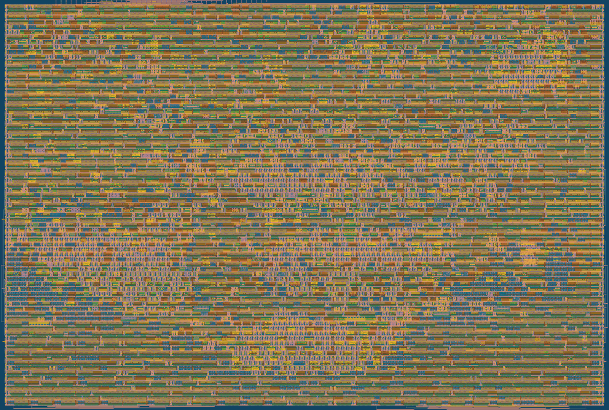

# Summary: tt_um_santhosh_rvsoc

Tiny Tapeout SKY 26d, sky130A, LibreLane 3.0.14. Generated by `scripts/make_summary.py` from `runs/wokwi/final/metrics.json`, `logs/precheck.log`, `logs/rtl_results.xml` and `logs/gl_results.xml`.



## Physical

| Item | Value |
|---|---|
| Tile size | 2x2 |
| Clock | 64 MHz (CLOCK_PERIOD 15.625 ns) |
| Placement density target | 86 % |
| Std-cell instances | 5752 |
| Std-cell area | 56923 um2 (core 72565 um2) |
| Utilisation | 78.4 % |
| Routed wire length | 198673 um |
| Setup WNS / TNS @ nom_tt_025C_1v80 | 1.991 / 0 ns |
| Setup WNS / TNS @ min_tt_025C_1v80 | 2.407 / 0 ns |
| Setup WNS / TNS @ max_tt_025C_1v80 | 1.587 / 0 ns |
| Setup WNS / TNS @ nom_ff_n40C_1v95 | 4.413 / 0 ns |
| Setup WNS / TNS @ nom_ss_100C_1v60 | -11.412 / -2112.159 ns |
| Hold WNS / TNS, worst of all 9 corners | 0.010 / 0 ns |
| Hold violations (all corners) | 0 |
| Magic DRC / KLayout DRC / route DRC | 0 / 0 (TT precheck) / 0 |
| LVS errors | 0 |
| Antenna violating nets / pins | 0 / 0 |
| Max slew violations @ nom_tt / all corners (informational) | 753 / 1880 |
| Max cap violations @ nom_tt / all corners (informational) | 0 / 24 |
| Power (STA estimate, tt) | 6.6 mW |

The flow enforces setup at the typical corners (`TIMING_VIOLATION_CORNERS = *tt*`) and hold at all corners; slew and capacitance are reported, not enforced. Slow-corner (ss, 100 C, 1.60 V) setup slack is for information. See `reports/sweep.md` and `docs/DESIGN_REPORT.md` section 8.5 for the explanation of the slew warnings.

## Tiny Tapeout precheck

**PASSED** (`scripts/precheck.sh`, log `logs/precheck.log`, reports `reports/precheck/`)

| Check | Errors |
|---|---|
| Magic DRC | 0 |
| KLayout beol | 0 |
| KLayout feol | 0 |
| KLayout nwell_urpm | 0 |
| KLayout offgrid | 0 |
| KLayout pin_label_purposes_overlapping_drawing | 0 |
| KLayout zero_area | 0 |
| top cell, layers, prBoundary, pins, Verilog | pass |

## RTL simulation

11/11 passed (wall time 44 min).

| Test | Result | Simulated time (ms) | Wall time (s) |
|---|---|---|---|
| test_soc.test_boot_hello | PASS | 1.382 | 94 |
| test_soc.test_isa_selftest | PASS | 0.562 | 24 |
| test_soc.test_psram | PASS | 0.907 | 42 |
| test_soc.test_timer_irq | PASS | 4.846 | 241 |
| test_soc.test_gpio_loopback | PASS | 0.394 | 20 |
| test_soc.test_uart_echo | PASS | 2.375 | 122 |
| test_soc.test_ext_irq | PASS | 2.482 | 181 |
| test_isa_random.test_start | PASS | 1.078 | 140 |
| test_isa_random.test_load_bug | PASS | 0.006 | 1 |
| test_isa_random.test_random_alu | PASS | 2.076 | 765 |
| test_isa_random.test_random | PASS | 3.380 | 1011 |

## Gate-level simulation

11/11 passed (wall time 56 min).

| Test | Result | Simulated time (ms) | Wall time (s) |
|---|---|---|---|
| test_soc.test_boot_hello | PASS | 1.382 | 191 |
| test_soc.test_isa_selftest | PASS | 0.562 | 74 |
| test_soc.test_psram | PASS | 0.907 | 128 |
| test_soc.test_timer_irq | PASS | 4.846 | 1699 |
| test_soc.test_gpio_loopback | PASS | 0.394 | 64 |
| test_soc.test_uart_echo | PASS | 2.375 | 393 |
| test_soc.test_ext_irq | PASS | 2.482 | 292 |
| test_isa_random.test_start | PASS | 1.078 | 158 |
| test_isa_random.test_load_bug | PASS | 0.006 | 1 |
| test_isa_random.test_random_alu | PASS | 0.247 | 226 |
| test_isa_random.test_random | PASS | 0.678 | 112 |

## FPGA (PYNQ-Z2, xc7z020)

PASS: Icarus simulation of the harness (`make -C fpga sim`).

Vivado 2025.1 flow (`fpga/pynq_z2/build_on_windows.ps1`: xsim RTL simulations, synthesis, implementation, bitstream, xsim on the post-route netlist), from `reports/fpga/vivado_summary.txt` (reports and logs in `reports/fpga/`):

```
xsim rtl_fast      : PASS (4.3 min)
xsim rtl_board     : PASS (13.8 min)
RVSOC_FPGA_RESULT: clock sysclk period 8.000 ns
RVSOC_FPGA_RESULT: clock clkfb period 40.000 ns
RVSOC_FPGA_RESULT: clock clk_mmcm period 15.625 ns
RVSOC_FPGA_RESULT: WNS=2.126 ns WHS=0.052 ns bitstream=C:/Users/santh/AppData/Local/Temp/rvsoc_vivado/repo/fpga/build/rvsoc_pynq_z2.bit
RVSOC_FPGA_RESULT: Slice LUTs: 2035 of 53200 (3.83 %)
RVSOC_FPGA_RESULT: Slice Registers: 952 of 106400 (0.89 %)
RVSOC_FPGA_RESULT: Block RAM Tile: 32 of 140 (22.86 %)
RVSOC_FPGA_RESULT: Bonded IOB: 33 of 125 (26.40 %)
RVSOC_FPGA_RESULT: MMCME2_ADV: 1 of 4 (25.00 %)
RVSOC_FPGA_RESULT: timing met
vivado build        : exit 0 (15.6 min)
xsim netlist_board : PASS (50.4 min)
```

Board test: deferred until the board is available.

## Hardening iterations

| Iter | Density % | Change tried | Furthest step | Util | GRT usage / overflows | Setup WNS tt (ss) ns | Hold WNS ns | DRC | LVS | Antenna nets | Result |
|---|---|---|---|---|---|---|---|---|---|---|---|
| it1 | 60 | TT template defaults | detailed placement | 83 % | - | +2.8 (-7.0) | - | - | - | - | FAIL DPL-0036: setup repair at the ss corner over-filled the core |
| it2 | 80 | `RSZ_CORNERS` = tt + ff; FENCE/CSR fixes | detailed placement | 90.5 % | - | +3.5 | - | - | - | - | FAIL DPL-0036: 300+ hold buffers for the 0.1 ns hold margin |
| it3 | 80 | no custom multiplier, nibble-serial timer, hold margin 0.05 / 0.03 | detailed routing | 82.9 % | 98.6 % / 4014 | met | met | - | - | - | STOPPED: routing violations not converging (36.7k -> 37.0k) |
| it4 | 80 | no Zicntr counters, 4-bit read bus, `MAX_FANOUT_CONSTRAINT` 16 | detailed routing | 82.7 % | 85.0 % / 1405 | +3.5 | met | - | - | - | STOPPED: 7411 violations after 9 passes, plateauing; 290 hold buffers |
| it5 | 75 | it4 without the register-file delay cells | hold repair | 82.1 % | - | - | - | - | - | - | STOPPED: hold repair added 641 buffers instead (delay cells kept) |
| it6 | 80 | it4 + hold margins PL 0.0 / GRT 0.02 | detailed routing | - | 68.85 % / 378 | met | met | - | - | - | STOPPED after it8 passed: 3 hold buffers; routing stuck at 2-3 violations for 50+ passes |
| it7 | 77 | it6 + density 77 | global routing | - | 68.85 % / 378 | - | - | - | - | - | STOPPED: identical to it6 (the placer raises any target below 84 % to 0.84, GPL-0302) |
| **it8** | **86** | **it6 + density 86** | **signoff** | **78.4 %** | **64.80 % / 165** | **+1.587 (-12.17)** | **+0.0096** | **0** | **clean** | **0** | **PASS: 0 routing violations at pass 20; final design** |

